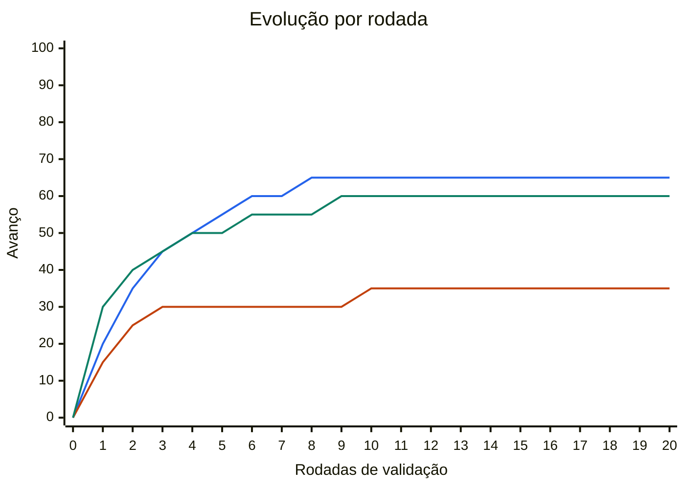

# Acompanhamento do simuladorCotacao

[Ver cronograma de entrega · 25/11 a 04/12/2026](CRONOGRAMA_ENTREGA.md)

**Estado em 25/11/2026 — Simulador 65/100 · Estratégias 35/100 (v5.8 OHLC: 51,7% · Scalper v1.1: 59,0% em 20 pregões conhecidos) · Dados 60/100.**

O eixo X segue a ordem das rodadas. O eixo Y vai de 0 (nenhum trabalho) a 100 (objetivo demonstrado). As notas são estimativas por marcos com evidência. Os números de operações da tabela se referem a cada rodada e podem reutilizar os mesmos pregões. As datas indicam a publicação das evidências no fuso America/Sao_Paulo. A rodada zero é uma referência sem data de publicação associada.

**Legenda** · 🔵 Simulador · 🟠 Estratégias NTSL · 🟢 Dados

[Abrir painel interativo no GitHub Pages](https://thiagozonda1989-stack.github.io/simuladorCotacao/colaboracao/ACOMPANHAMENTO_INTERATIVO.html). Passe o mouse sobre uma linha ou ponto para ver o nome da série, a rodada e o percentual.

| Rodada | Publicação | Marco | Simulador | Estratégias (progresso e acerto) | Dados | Evidência e operações |
|---:|---|---|---:|---:|---:|---|
| 0 | — | Início | 0 | 0 · acerto — | 0 | Marco zero do gráfico |
| 1 | 19/11/2026 | Inventário WIN | 20 | 15 · acerto — | 30 | 25 arquivos de cinco pregões e replay sintético. [fd7f7ef](https://github.com/thiagozonda1989-stack/simuladorCotacao/commit/fd7f7efffd47b3e8f1521a93bb01595eb1d3d679) |
| 2 | 19/11/2026 | Paridade de 21/10 | 35 | 25 · acerto — | 40 | 10/10 operações no recorte da v5.7. [a5a5420](https://github.com/thiagozonda1989-stack/simuladorCotacao/commit/a5a5420b4fe8a10e4016c62c4eb7660b472a6b50) |
| 3 | 20/11/2026 | Proteção na entrada | 45 | 30 · acerto — | 45 | 26/10 passou de 8/12 para 11/12 no modo intermediário. [ec7b644](https://github.com/thiagozonda1989-stack/simuladorCotacao/commit/ec7b6442359367e1e92abe79d9321894ce442583) |
| 4 | 20/11/2026 | Avaliação pós-preenchimento | 50 | 30 · acerto — | 50 | 26/10 chegou a 12/12 no modo experimental, incluindo a #182. [742b093](https://github.com/thiagozonda1989-stack/simuladorCotacao/commit/742b093e29cab338c9345cbe5b42e5de0e4c6f8d) |
| 5 | 21/11/2026 | Sondas v5.8 | 55 | 30 · acerto — | 50 | S1 e S2 investigaram persistência e stop-limit. [a1f693e](https://github.com/thiagozonda1989-stack/simuladorCotacao/commit/a1f693e8c73e4fce272d2c8b213a743b568a5f32) |
| 6 | 23/11/2026 | Prioridade de saída | 60 | 30 · acerto — | 55 | Quatro cenários nativos compararam proteção isolada e saída a mercado. [7fca120](https://github.com/thiagozonda1989-stack/simuladorCotacao/commit/7fca12005a319a4feeb859054e7cfcffe3ec4926) |
| 7 | 23/11/2026 | Grade G1/G2 | 60 | 30 · acerto — | 55 | Duas sondas deram suporte ao tick mais próximo nas saídas de posição comprada. [723838a](https://github.com/thiagozonda1989-stack/simuladorCotacao/commit/723838af659a8a1e3145ba22e00468dd8feae6d8) |
| 8 | 23/11/2026 | Ajuste experimental à grade | 65 | 30 · acerto — | 55 | Opção OHLC para saída de posição comprada, 130 testes e 32 replays privados reportados. [ca1b602](https://github.com/thiagozonda1989-stack/simuladorCotacao/commit/ca1b602481e25802d0d5369afa159c677dc5316e) |
| 9 | 23/11/2026 | Grade G3/G4 e 03 | 65 | 30 · acerto — | 60 | Três operações nativas. G3/G4 confirmam os exemplos de recompra. Os níveis aceitos da 03 seguem pendentes. [d37a339](https://github.com/thiagozonda1989-stack/simuladorCotacao/commit/d37a339a6ea750b36b9aaf6d7afad9ca63698265) |
| 10 | 23/11/2026 | Protocolo fora da amostra | 65 | 35 · acerto v1.0: 36,1% (13/36, sintético) | 60 | Pullback de tendência v1.0 em 60 pregões **sintéticos**: 50 variações só no treino, escolha única avaliada no teste (36 operações, −R$ 457, IC da média diária −46,56 a −4,39). Estratégia rejeitada; o protocolo e as métricas do critério ficam implementados e testados. [f8098e5](https://github.com/thiagozonda1989-stack/simuladorCotacao/blob/f8098e50689df9c8e4e74e2cd31f91448eb2d4c3/docs/colaboracao/evidencias/estrategia_pullback_fora_amostra_sintetico_v1/README.md) |
| 11 | 24/11/2026 | Pullback v1.1 | 65 | 35 · acerto v1.1: 50,0% (2/4, real) e 43,5% (47/108, sintético novo) | 60 | 4 operações por versão no WIN real, com redução da perda. 108 por versão em sintéticos novos, com piora. [Relatório](evidencias/estrategia_pullback_confirmacao_v1_1/README.md) |
| 12 | 24/11/2026 | Pullback em 20 pregões reais | 65 | 35 · v1.1: 54,8% (23/42), v1.3: 35,7% (15/42) | 60 | Candidata rejeitada. Líquido v1.1 −R$ 286 e v1.3 −R$ 331. [Relatório](https://github.com/thiagozonda1989-stack/simuladorCotacao/blob/aec29307c67f1b837d7532fde4fe9d51c2f02b71/docs/colaboracao/evidencias/estrategia_pullback_20_pregoes_v1/README.md) |
| 13 | 24/11/2026 | Busca de parâmetros da v1.3 | 65 | 35 · perfil curto: 39,6% (91/230) | 60 | 48 combinações em 19 pregões. Em 20 pregões já conhecidos, melhor perfil reavaliado fez 11,5 operações/dia, 1 min 51 s, −R$ 143 e drawdown de R$ 338. Meta diária não atingida. [Resultados](https://github.com/thiagozonda1989-stack/simuladorCotacao/blob/1aa8495327225755998605198c5a2f2236aeb5ed/docs/colaboracao/evidencias/estrategia_pullback_busca_curta_v1/resultado.json) |
| 14 | 24/11/2026 | v1.4, dois contratos e alvo dinâmico | 65 | 35 · 41,3% (99/240) | 60 | 24 configurações em 19 pregões. Em 20 pregões conhecidos, alvo de 50 a 220 pts e 12 operações/dia. O controle com os mesmos filtros teve 12,45/dia e 38,2% de acerto. Líquido −R$ 1.284 no dinâmico e −R$ 590 no controle. [Resultados](https://github.com/thiagozonda1989-stack/simuladorCotacao/blob/ea7c8dbc9e8c6910d0f13f3603c996436fab0288/docs/colaboracao/evidencias/estrategia_pullback_alvo_dinamico_v1/resultado.json) |
| 15 | 24/11/2026 | Stops adaptativos v1.5 e v1.6 | 65 | 35 · v1.5: 36,5% (84/230) · v1.6: 26,7% (12/45) | 60 | 12 configurações. Líquido de −R$ 480 e −R$ 504 em 20 pregões conhecidos. [Relatório](evidencias/estrategia_pullback_adaptativo_v1/README.md) |
| 16 | 24/11/2026 | Falha de rompimento v1.7 | 65 | 35 · controle v1.5: 36,5% (84/230) | 60 | 4 variantes rejeitadas em 19 pregões. Melhor Δ −R$ 254 e 149 operações. Controle OFF reproduziu −R$ 480 em 20 conhecidos. [Relatório](https://github.com/thiagozonda1989-stack/simuladorCotacao/blob/9e160857194084f6bf4bc945a0ab0f399f44f8e6/docs/colaboracao/evidencias/estrategia_pullback_falha_rompimento_v1/README.md) |
| 17 | 24/11/2026 | Otimização v5.7 de R$ 5.745 | 65 | 35 · acerto da variação pendente | 60 | 43 operações informadas, pareamento pendente. Inventário, configuração e roteiro com 132 testes. [Relatório](https://github.com/thiagozonda1989-stack/simuladorCotacao/blob/d2429a4549b497fcdbdb0cfef04e02c01d6be997/docs/colaboracao/evidencias/WINZ26_v5_7_otimizacao_rodada17_v1/README.md) |
| 18 | 24/11/2026 | Busca genética WINZ26 | 65 | 35 · Scalper v1.1 59,0% (49/83, exploratório) | 60 | 20 versões e 1.228 avaliações. Melhor candidato de 1 min e 2 contratos fez −R$ 58 em 20 pregões conhecidos. Reserva inédita preservada. [Relatório](https://github.com/thiagozonda1989-stack/simuladorCotacao/blob/4b195d9c6a0e3fd8e2e92eda71c0827dd9870cb5/docs/colaboracao/evidencias/WINZ26_ag_rodada18_v1/README.md) |
| 19 | 25/11/2026 | Perfis congelados e diagnóstico WINZ26 | 65 | 35 · v5.8 51,7% (76/147) · Scalper v1.1 59,0% (49/83) | 60 | Em 20 conhecidos, v5.8 original R$ 1.902 e Scalper −R$ 58. Diagnóstico v5.8 otimizada −R$ 2.022 (86 operações). Reserva 23/11 só OHLC, sem replay. [Evidências](https://github.com/thiagozonda1989-stack/simuladorCotacao/blob/dda2cff06801218e8768e4e255295b683e3b18c1/docs/colaboracao/evidencias/WINZ26_congelamento_rodada19_v1/README.md) |
| 20 | 25/11/2026 | Auditoria da reserva WINZ26 | 65 | 35 · zero operações inéditas | 60 | 24/11 tem 565 barras com os campos exigidos. Piloto bloqueado pela confirmação da abertura e do candle das 18:14 de 23/11, pregão de aquecimento. [Decisão e protocolo](https://github.com/thiagozonda1989-stack/simuladorCotacao/blob/a80ca00f50914dcacc624f1a2068b00c963f51b4/docs/colaboracao/evidencias/WINZ26_decisao_elegibilidade_rodada20_v2/README.md) |

## Cálculo da taxa de acerto

Taxa de acerto = operações encerradas com resultado líquido positivo ÷ total de operações encerradas × 100. O resultado líquido inclui os custos e o slippage do protocolo. Operações no zero ficam no denominador. Para combinar pregões da mesma amostra, some os acertos e as operações antes de dividir. Sem amostra, use “—”. Calcule separadamente para dados reais e sintéticos.

| Amostra | v1.0 | v1.1 | Variação |
|---|---:|---:|---:|
| WINZ26 real, 21 e 26/10 | 25,0% (1/4) | 50,0% (2/4) | +25,0 p.p. |
| Sintético original | 36,1% (13/36) | 36,1% (13/36) | 0,0 p.p. |
| Sintético novo | 47,2% (51/108) | 43,5% (47/108) | −3,7 p.p. |

A linha laranja do gráfico representa o progresso do projeto, hoje em 35/100. A taxa de acerto mede operações lucrativas. A meta de 95% por classe mede a classificação dos sinais e continua sendo avaliada separadamente.

## Critério para chegar a 100

- **Simulador.** Execução OHLC e tick a tick validada no escopo do projeto, com regressões de ordens, lacunas e preenchimentos, e cenários com custos, slippage e latência.
- **Estratégias.** Modelos de compra e venda avaliados fora da amostra por ativo e intervalo, com precisão e sensibilidade por classe, frequência, exposição e resultado líquido. Os 95% por classe são uma meta de pesquisa.
- **Dados.** Fontes WIN e WDO elegíveis, cobertura documentada, ordem temporal verificável e integração causal entre negócios, preços e ofertas. Variáveis e indicadores têm origem, fórmula e testes registrados.

## Atualização no encerramento de cada rodada

Quem publica a rodada acrescenta uma linha com data local, marco, notas das três frentes, quantidade ou correspondência das operações quando disponível e link fixo para o SHA da evidência. Atualiza também as três séries e o resumo no topo. Se uma nota mudar, registra qual evidência motivou a mudança. Registra a rodada mesmo quando as notas permanecem iguais. Inclui o link deste painel no fechamento do PR. Os revisores conferem a coerência com as evidências.

O ajuste implementado na rodada 8 justifica os cinco pontos adicionais do simulador. A captura nativa da rodada 9 justifica os cinco pontos adicionais dos dados. Na rodada 10, as estratégias sobem de 30 para 35 pela implementação do protocolo fora da amostra com todas as métricas do critério (matriz de confusão, precisão e sensibilidade com incerteza, custo dos falsos positivos, frequência, exposição, resultado líquido e drawdown). A nota não reflete desempenho: os dados são sintéticos e a estratégia testada foi rejeitada. Desempenho real exige aplicar o mesmo protocolo a pregões WIN reais.
