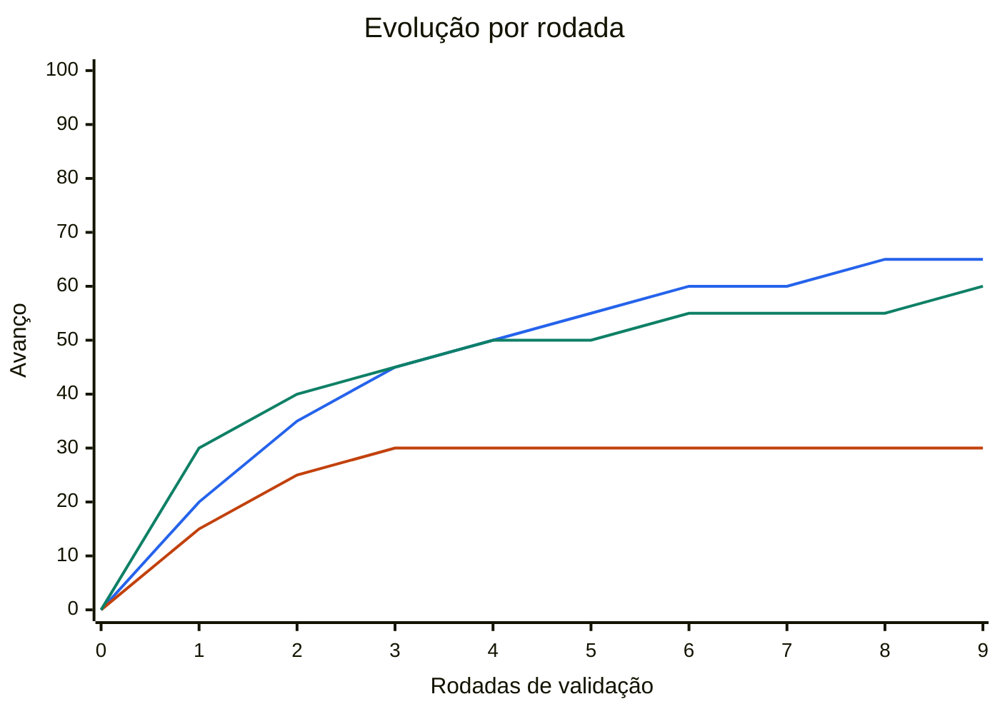

# Acompanhamento do simuladorCotacao

**Estado em 23/11/2026 — Simulador 65/100 · Estratégias 30/100 · Dados 60/100.**

O eixo X segue a ordem das rodadas. O eixo Y vai de 0 (nenhum trabalho) a 100 (objetivo demonstrado). As notas são estimativas por marcos com evidência. Os números de operações da tabela se referem a cada rodada e podem reutilizar os mesmos pregões. As datas indicam a publicação das evidências no fuso America/Sao_Paulo. A rodada zero é uma referência sem data de publicação associada.

**Linhas:** azul para simulador, laranja para estratégias NTSL e verde para dados.

| Rodada | Publicação | Marco | Simulador | Estratégias | Dados | Evidência e operações |
|---:|---|---|---:|---:|---:|---|
| 0 | — | Início | 0 | 0 | 0 | Marco zero do gráfico |
| 1 | 19/11/2026 | Inventário WIN | 20 | 15 | 30 | 25 arquivos de cinco pregões e replay sintético. [fd7f7ef](https://github.com/thiagozonda1989-stack/simuladorCotacao/commit/fd7f7efffd47b3e8f1521a93bb01595eb1d3d679) |
| 2 | 19/11/2026 | Paridade de 21/10 | 35 | 25 | 40 | 10/10 operações no recorte da v5.7. [a5a5420](https://github.com/thiagozonda1989-stack/simuladorCotacao/commit/a5a5420b4fe8a10e4016c62c4eb7660b472a6b50) |
| 3 | 20/11/2026 | Proteção na entrada | 45 | 30 | 45 | 26/10 passou de 8/12 para 11/12 no modo intermediário. [ec7b644](https://github.com/thiagozonda1989-stack/simuladorCotacao/commit/ec7b6442359367e1e92abe79d9321894ce442583) |
| 4 | 20/11/2026 | Avaliação pós-preenchimento | 50 | 30 | 50 | 26/10 chegou a 12/12 no modo experimental, incluindo a #182. [742b093](https://github.com/thiagozonda1989-stack/simuladorCotacao/commit/742b093e29cab338c9345cbe5b42e5de0e4c6f8d) |
| 5 | 21/11/2026 | Sondas v5.8 | 55 | 30 | 50 | S1 e S2 investigaram persistência e stop-limit. [a1f693e](https://github.com/thiagozonda1989-stack/simuladorCotacao/commit/a1f693e8c73e4fce272d2c8b213a743b568a5f32) |
| 6 | 23/11/2026 | Prioridade de saída | 60 | 30 | 55 | Quatro cenários nativos compararam proteção isolada e saída a mercado. [7fca120](https://github.com/thiagozonda1989-stack/simuladorCotacao/commit/7fca12005a319a4feeb859054e7cfcffe3ec4926) |
| 7 | 23/11/2026 | Grade G1/G2 | 60 | 30 | 55 | Duas sondas deram suporte ao tick mais próximo nas saídas de posição comprada. [723838a](https://github.com/thiagozonda1989-stack/simuladorCotacao/commit/723838af659a8a1e3145ba22e00468dd8feae6d8) |
| 8 | 23/11/2026 | Ajuste experimental à grade | 65 | 30 | 55 | Opção OHLC para saída de posição comprada, 130 testes e 32 replays privados reportados. [ca1b602](https://github.com/thiagozonda1989-stack/simuladorCotacao/commit/ca1b602481e25802d0d5369afa159c677dc5316e) |
| 9 | 23/11/2026 | Grade G3/G4 e 03 | 65 | 30 | 60 | Três operações nativas. G3/G4 confirmam os exemplos de recompra. Os níveis aceitos da 03 seguem pendentes. [d37a339](https://github.com/thiagozonda1989-stack/simuladorCotacao/commit/d37a339a6ea750b36b9aaf6d7afad9ca63698265) |

## Critério para chegar a 100

- **Simulador.** Execução OHLC e tick a tick validada no escopo do projeto, com regressões de ordens, lacunas e preenchimentos, e cenários com custos, slippage e latência.
- **Estratégias.** Modelos de compra e venda avaliados fora da amostra por ativo e intervalo, com precisão e sensibilidade por classe, frequência, exposição e resultado líquido. Os 95% por classe são uma meta de pesquisa.
- **Dados.** Fontes WIN e WDO elegíveis, cobertura documentada, ordem temporal verificável e integração causal entre negócios, preços e ofertas. Variáveis e indicadores têm origem, fórmula e testes registrados.

## Atualização no encerramento de cada rodada

Quem publica a rodada acrescenta uma linha com data local, marco, notas das três frentes, quantidade ou correspondência das operações quando disponível e link fixo para o SHA da evidência. Atualiza também as três séries e o resumo no topo. Se uma nota mudar, registra qual evidência motivou a mudança. Registra a rodada mesmo quando as notas permanecem iguais. Inclui o link deste painel no fechamento do PR. Os revisores conferem a coerência com as evidências.

O ajuste implementado na rodada 8 justifica os cinco pontos adicionais do simulador. A captura nativa da rodada 9 justifica os cinco pontos adicionais dos dados. As estratégias mantêm a nota enquanto se aguarda nova evidência de desempenho fora da amostra.
